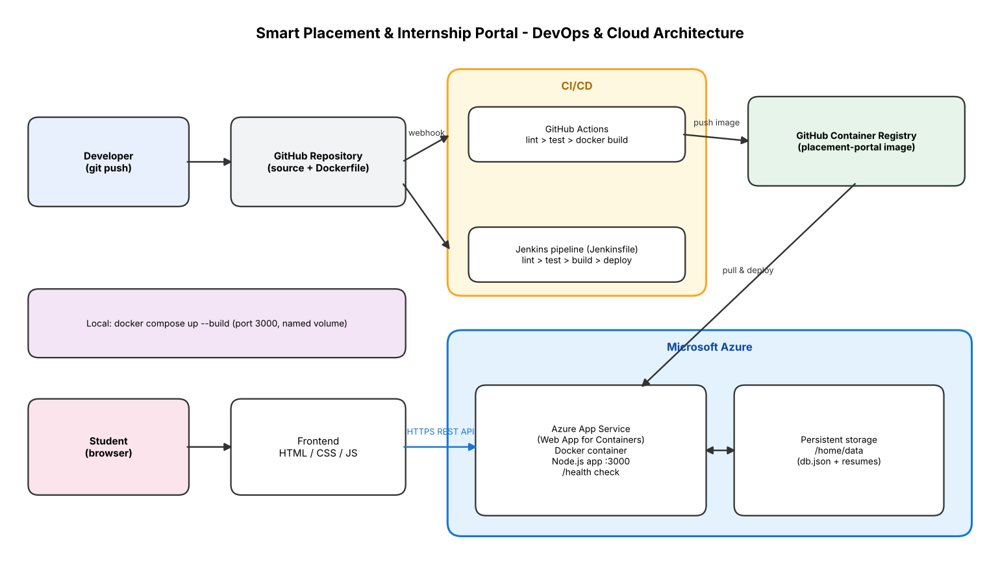

# Smart Placement & Internship Portal

A small web app where students create a profile, upload a resume, browse internships, apply, and track application status. A basic skill-matching feature ranks internships by how many required skills the student already has.

## Tech stack
- Frontend: HTML, CSS, JavaScript
- Backend: Node.js (built-in `http` module, JSON file storage)
- DevOps: Docker, Docker Compose, Jenkins (Jenkinsfile), GitHub Actions (YAML)

## Skill matching
`match % = (skills the student has / skills the internship requires) x 100` (see `src/match.js`).

## Problem statement
Students track internships across spreadsheets and chats, and can't easily tell which openings fit their skills. This portal gives one place to keep a profile and resume, see internships ranked by skill match, and track application status.

## Architecture


## Run locally
```bash
npm test
npm start            # http://localhost:3000
```

## Run with Docker
```bash
docker compose up --build -d
```

## CI/CD
- **GitHub Actions** (`.github/workflows/ci.yml`): lint, test, build the image and smoke-test the container on every push/PR.
- **Jenkins** (`Jenkinsfile`): Checkout, Lint, Test, Build Docker Image, Deploy, Smoke Test.

## Cloud deployment
Deployed on Render (Docker web service, free tier). Render builds the Dockerfile from this repo and redeploys on every push to main. Setup: docs/DEPLOYMENT.md

## API
| Method | Endpoint | Purpose |
|---|---|---|
| GET/PUT | /api/profile | View / update profile |
| POST | /api/resume | Upload resume |
| GET | /api/internships?q= | List internships with match score |
| GET/POST | /api/applications | List / apply |
| PATCH/DELETE | /api/applications/:id | Update status / withdraw |
| GET | /health | Health check |

## Folder structure
```
src/        server, matching logic, internship data
public/     HTML, CSS, JS frontend
test/       unit and API tests
docs/        architecture diagram and deployment guide
Dockerfile, docker-compose.yml, Jenkinsfile, .github/workflows/ (ci.yml, deploy-azure.yml)
```
